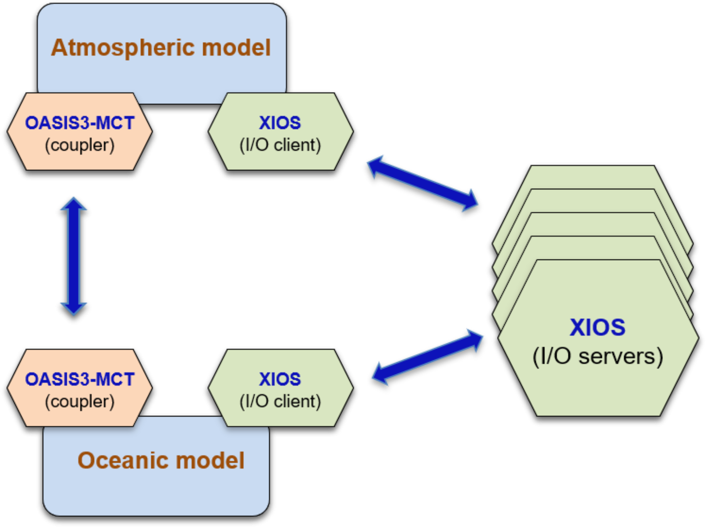
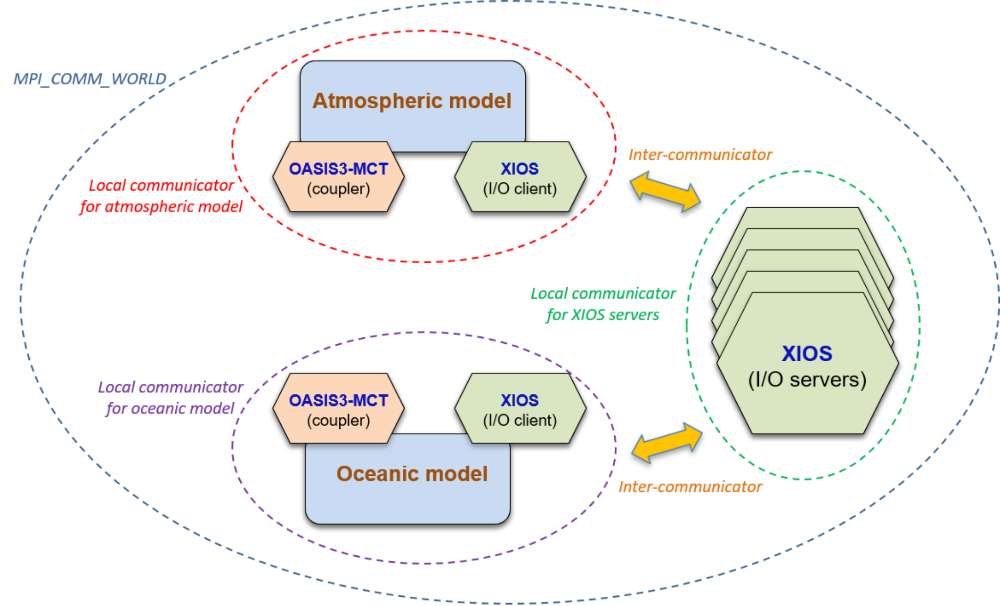

# Joint usage of OASIS3-MCT and XIOS in climate models

_Arnaud Caubel (LSCE/IPSL), March 2026 update_

Both OASIS3-MCT (CERFACS) and XIOS (LSCE/IPSL) are widely used in the climate modeling community, respectively to handle coupling and Input/Output in numerical models. Since the exchange protocol of these tools are based on messages within MPI communicators which can be shared by the tools, some good practices are useful to use conjointly OASIS3-MCT and XIOS within one same model ([Fig 1.](#fig-coupled-model))


<a id="fig-coupled-model"></a>

**Figure 1 : Coupled model using OASIS3-MCT as coupler and XIOS as I/O server**
<!-- Voir la [Figure 5.1](#fig-coupled-model) -->

<!-- Note that following information is related to XIOS 2.5 or trunk version and OASIS3-MCT_2.0 or later. -->

## 1. Interfacing with OASIS3-MCT and XIOS within a climate model

### a. Initialisation phase

From the OASIS3-MCT and XIOS point of view, the objective of this step is both to initialize the MPI library (calling MPI_Init), if not already initialized by the model, and to create a local communicator to be used by the model for its internal parallelization ([Fig 2](#fig-coupled-comms)). Both OASIS3-MCT and XIOS fulfill these functions thanks to `oasis_init_comp` and `oasis_get_localcomm` API routines for OASIS3-MCT and `xios_initialize` (that calls the OASIS3-MCT API routines) for XIOS. In order to avoid duplicating tasks, the call to these API routines must be ordered in the component as proposed in the two following examples:

<a id="ex-init-both"></a>
``` {.fortran language="Fortran" breaklines="true" tabsize="2" frame="tb" postbreak="\raisebox{0ex}[0ex][0ex]{\ensuremath{\rcurvearrowse\space}}"}
CALL oasis_init_comp( comp_id, "ocean", status)                                        
CALL oasis_get_localcomm (ilocal_comm, status )	               (1)
CALL xios_initialize( "ocean", local_comm=ilocal_comm , return_comm=ilocal_comm)
```
or
<a id="ex-init"></a>
``` {.fortran language="Fortran" breaklines="true" tabsize="2" frame="tb" postbreak="\raisebox{0ex}[0ex][0ex]{\ensuremath{\rcurvearrowse\space}}"}
CALL xios_initialize( "ocean", return_comm=ilocal_comm)        (2)
```

In case ([1](#ex-init-both)), the call to OASIS3-MCT initialization API routines allows to initialize the MPI library (calling MPI_Init if not already initialized by the model) and to get the value `ilocal_comm` of a local communicator handle. Then, the call to `xios_initialize` returns `return_comm` the handle of a communicator that is in fact a duplication of the `local_comm` communicator. _Note that XIOS 3 requires to use this specification._

In case ([2](#ex-init)), XIOS handles the initialization of OASIS3-MCT (and MPI if needed) by calling internally `oasis_init_comp` and `oasis_get_localcomm` API routines and returning the split local communicator handle as `return_comm` argument. 

In both cases (1) and (2), the call to `xios_initialize` allows XIOS to pick up an inter-communicator between the model component (XIOS client) and XIOS servers by calling the  OASIS3-MCT `oasis_get_intercomm` API routine: this inter-communicator is needed by XIOS to create a communicator and achieve communications between model component processes and XIOS servers ([Fig 2](#fig-coupled-comms)). 


<a id="fig-coupled-comms"></a>

**Figure 2 : Handling of MPI communicators in a coupled model using OASIS3-MCT as coupler and XIOS as I/O server**
<!-- Voir la [Figure 5.1](#fig-coupled-comms) -->


### b. Definition phase

In the model component, the OASIS3-MCT definition phase is finalised by calling the  `oasis_enddef` API routine. This routine includes global collective MPI communications (using the MPI_COMM_WORLD communicator). The XIOS `xios_context_initialize` subroutine initializes one or several XIOS context(s) and also includes collective MPI communications. Hence, deadlocks may occur if the developer does not pay any attention to the calling order of the two subroutines. The calling rule depends on the version of XIOS, as follows:

- (i) XIOS version branch 2.5 or trunk (before revision 1587)

In order to avoid deadlocks, it is mandatory to call first `oasis_enddef` and then `xios_context_initialize` in all the components involved in the coupling, to be coherent with the calling order of XIOS servers. A calling sequence in your models could be as follows:

``` {.fortran language="Fortran" breaklines="true" tabsize="2" frame="tb" postbreak="\raisebox{0ex}[0ex][0ex]{\ensuremath{\rcurvearrowse\space}}"}
CALL oasis_enddef
…
CALL xios_context_initialize (xios_context, local_comm)
```

- (ii) XIOS version trunk (revision 1587 or later, including XIOS 3 up to [XIOS-3.0.2.0](https://gitlab.in2p3.fr/ipsl/projets/xios-projects/xios/-/tags))

A XIOS functionality was developed to explicitly inform XIOS servers they have to call `oasis_enddef` function. This function, `xios_oasis_enddef`, allows to solve deadlocks encountered in case of bad call order of `oasis_enddef` and `xios_context_initialize`.
The call to `xios_oasis_enddef` needs to be implemented before the call to `oasis_enddef` on model side as follows:

``` {.fortran language="Fortran" breaklines="true" tabsize="2" frame="tb" postbreak="\raisebox{0ex}[0ex][0ex]{\ensuremath{\rcurvearrowse\space}}"}
…
CALL xios_oasis_enddef 
CALL oasis_enddef
…
CALL xios_context_initialize (xios_context, local_comm)
…
```

or

``` {.fortran language="Fortran" breaklines="true" tabsize="2" frame="tb" postbreak="\raisebox{0ex}[0ex][0ex]{\ensuremath{\rcurvearrowse\space}}"}
CALL xios_context_initialize (xios_context, local_comm)
…
CALL xios_oasis_enddef
CALL oasis_enddef
…
```

The XIOS parameter `call_oasis_enddef` (default value is `true`) must be set in iodef.xml file:

- `true`: `xios_oasis_enddef` function must be called in every component involved in the coupling.
- `false`: the functionality is deactivated and the behavior of XIOS version branch 2.5 or trunk < revision 1587 is retrieved, i.e. `xios_oasis_enddef` function does not need to be called in the models but deadlocks may happen in case of bad call order of `oasis_enddef` and `xios_context_initialize`.  

<br>

- (iii) From [XIOS-3.0.2.0](https://gitlab.in2p3.fr/ipsl/projets/xios-projects/xios/-/tags) :

The XIOS servers benefit from the `coupled` option of `oasis_init_comp`, this allows the servers to be not considered during the collective MPI communications of OASIS (in `oasis_enddef` and `oasis_terminate`).
The call to `xios_oasis_enddef` and the XIOS parameter `call_oasis_enddef` have become useless.


### c. Finalisation phase

The finalization sequence must be similar to the initialization one. If OASIS3-MCT has initialized MPI (`oasis_init_comp`), the MPI finalization will be done by OASIS3-MCT in the `oasis_terminate` API routine, either called directly by the model (case ([3](#ex-terminate-both))) or within `xios_finalize` (case ([4](#ex-terminate))).

<a id="ex-terminate-both"></a>
``` {.fortran language="Fortran" breaklines="true" tabsize="2" frame="tb" postbreak="\raisebox{0ex}[0ex][0ex]{\ensuremath{\rcurvearrowse\space}}"}
CALL xios_finalize                                                            (3)
CALL oasis_terminate    
```

or

<a id="ex-terminate"></a>
``` {.fortran language="Fortran" breaklines="true" tabsize="2" frame="tb" postbreak="\raisebox{0ex}[0ex][0ex]{\ensuremath{\rcurvearrowse\space}}"}
CALL xios_finalize                                                            (4)```
```


## 2. Compilation parameters
### XIOS

Compilation with `--use_oasis` is mandatory to use OASIS3-MCT API routines in XIOS (XIOS C-fortran interface of OASIS3-MCT API routines is defined only if `--use_oasis` is specified).

```bash
./make_xios --use_oasis…
```

### OASIS3-MCT

Nothing to do at compilation step.


## 3. Runtime parameters
### XIOS : iodef.xml

Some OASIS3-MCT parameters have to be enabled in iodef.xml:

- `using_oasis`: true if OASIS3-MCT is used as coupler. Default value: `false`.
- `call_oasis_enddef` : see [part 1.b](#b-definition-phase); default value is `true`.
- `oasis_code_id` (XIOS 2)/`clients_code_id` (XIOS 3): identifiers of model component using both OASIS3-MCT and XIOS (these identifiers must be the same as the one defined as argument of `oasis_init_comp` and `xios_context_initialize` API routine). Only used if XIOS server mode is enabled.

    - XIOS 2 : 
```xml
  <variable id="using_oasis"     type="bool">true</variable>
  <variable id="oasis_codes_id"  type="string" >atmos,ocean</variable>
```
- XIOS 3 : 
```xml
  <variable id="using_oasis"     type="bool">true</variable>
  <variable id="clients_code_id"  type="string" >atmos,ocean</variable>
```

### OASIS3-MCT : namcouple

With OASIS3-MCT version prior to 3.0, model identifiers defined in XIOS iodef.xml must be the same as the one defined in the OASIS3-MCT namcouple configuration file and the one defined as argument of `oasis_init_comp` API routine. xios.x is the identifier to be used for XIOS component in namcouple file, as follows:
```
$NBMODEL 
3 atmos ocean xios.x
```

We note however that since version 3.0 of OASIS3-MCT, this namcouple parameter is not used anymore. 

