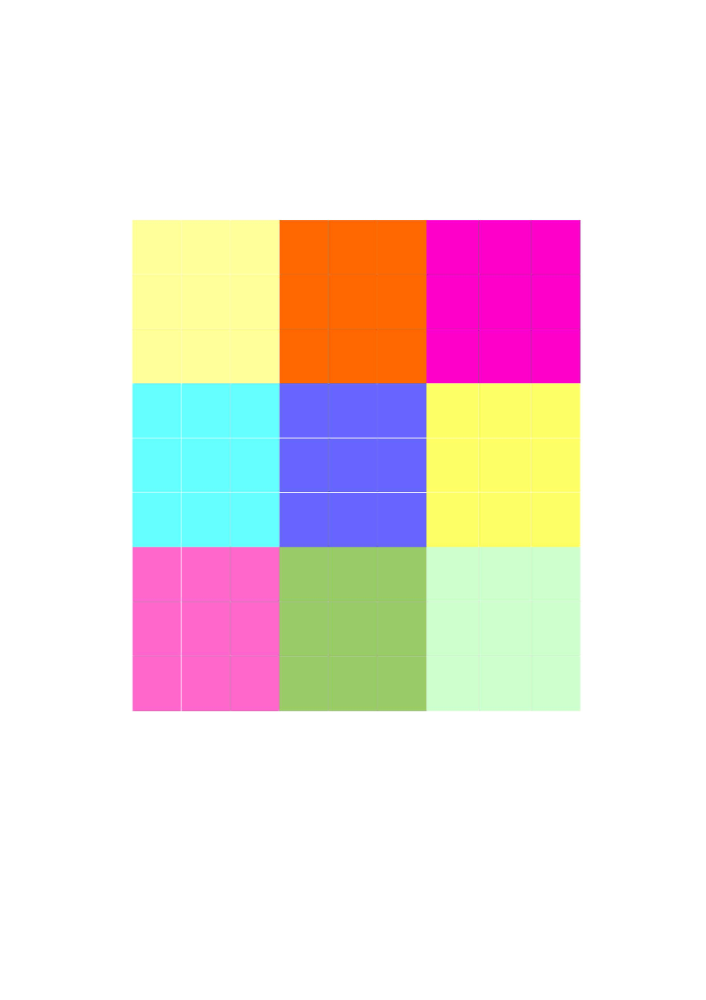
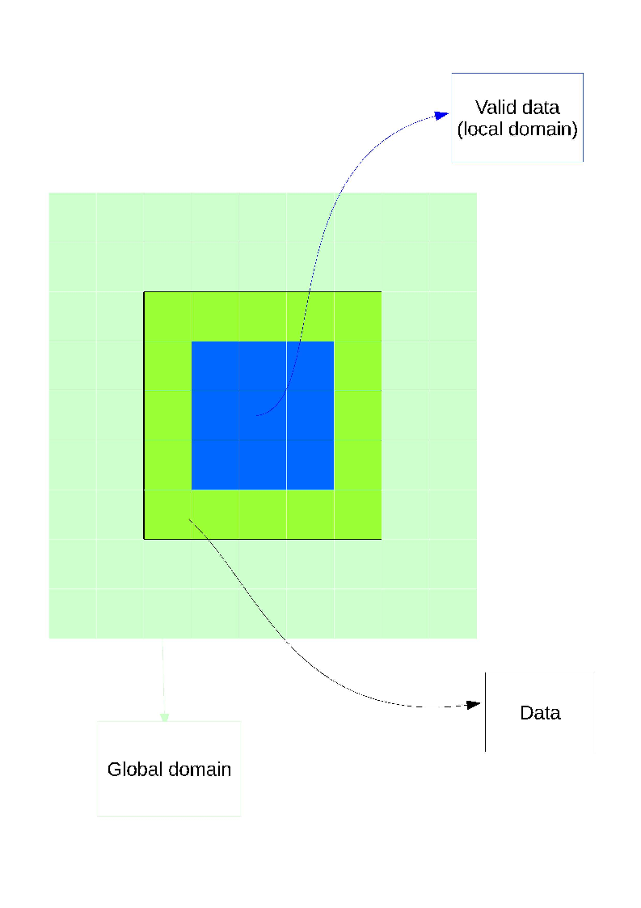
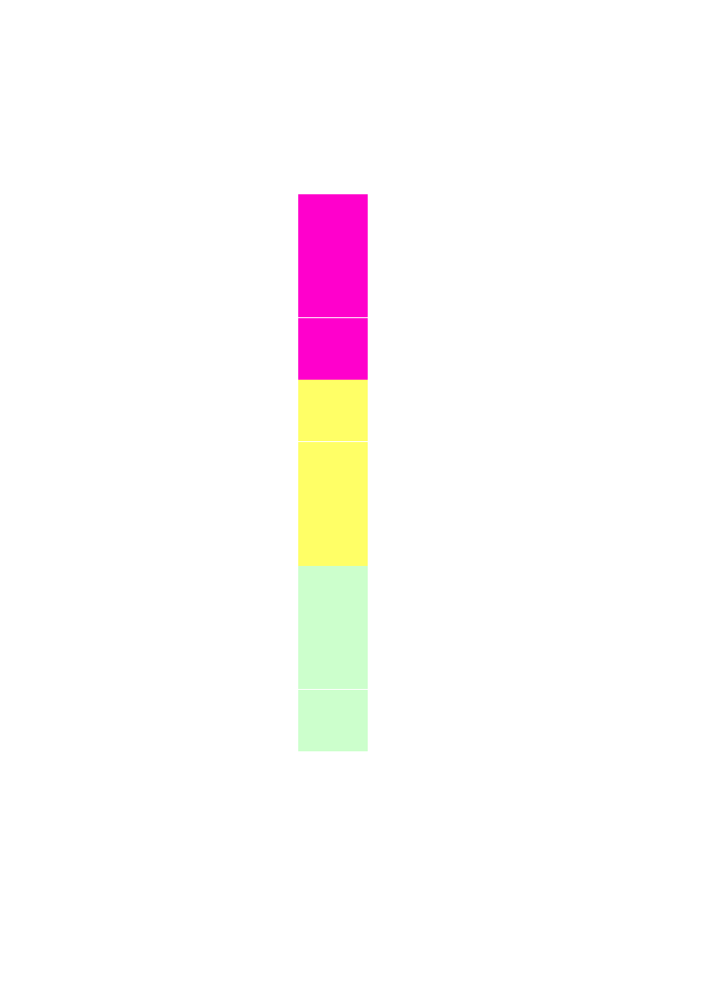
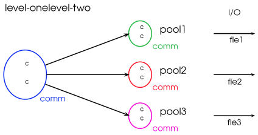

## Calendar


### How to define a calendar


XIOS has an embedded calendar module which needs to be configured before
you can run your simulation.

Only the calendar type and the time step used by your simulation are
mandatory to have a well defined calendar. For example, a minimal
calendar definition could be:

-   from the XML configuration file:

    ``` {.xml language="XML" breaklines="true" tabsize="2" frame="tb" postbreak="\raisebox{0ex}[0ex][0ex]{\ensuremath{\rcurvearrowse\space}}"}
    <?xml version="1.0"?>
    <simulation>
        <context id="test">
            <calendar type="Gregorian" timestep="1.5h" />
        </context>
    </simulation>
    ```

-   from the Fortran interface:

    ``` {.fortran language="Fortran" breaklines="true" tabsize="2" frame="tb" postbreak="\raisebox{0ex}[0ex][0ex]{\ensuremath{\rcurvearrowse\space}}"}
    ! ...
    TYPE(xios_context) :: ctx_hdl
    ! ...
    ! Context initialization ommited, see the corresponding section of this user manual and of the reference manual
    CALL xios_get_handle("test",ctx_hdl)
    CALL xios_set_current_context(ctx_hdl)
    CALL xios_define_calendar(type="Gregorian", timestep=1.5*xios_hour)
    ```

The calendar type definition is done once and for all, either from the
XML configuration file or the Fortran interface, and cannot be modified.
However there is no such restriction regarding the time step which can
be defined at a different time than the calendar type and even redefined
multiple times.

For example, it is possible to the achieve the same minimal
configuration as above by using both the XML configuration file:

``` {.xml language="XML" breaklines="true" tabsize="2" frame="tb" postbreak="\raisebox{0ex}[0ex][0ex]{\ensuremath{\rcurvearrowse\space}}"}
<?xml version="1.0"?>
<simulation>
    <context id="test">
        <calendar type="Gregorian" />
    </context>
</simulation>
```

and the Fortran interface:

``` {.fortran language="Fortran" breaklines="true" tabsize="2" frame="tb" postbreak="\raisebox{0ex}[0ex][0ex]{\ensuremath{\rcurvearrowse\space}}"}
! ...
TYPE(xios_context) :: ctx_hdl
! ...
! Context initialization ommited, see the corresponding section of this user manual and of the reference manual
CALL xios_get_handle("test",ctx_hdl)
CALL xios_set_current_context(ctx_hdl)
! xios_define_calendar cannot be used here because the type was already defined in the configuration file.
! Ommiting the following line would lead to an error because the timestep would be undefined.
CALL xios_set_timestep(timestep=1.5*xios_hour)
```

The calendar also has two optional date parameters:

-   the start date which corresponds to the beginning of the simulation

-   the time origin which corresponds to the origin of the time axis.

If they are undefined, those parameters are set by default to
"***0000-01-01 00:00:00***". If you are not interested in specific
dates, you can ignore those parameters completely. However if you wish
to set them, please note that they must not be set before the calendar
is defined. Thus the following XML configuration file would be for
example invalid:

``` {.xml language="XML" breaklines="true" tabsize="2" frame="tb" postbreak="\raisebox{0ex}[0ex][0ex]{\ensuremath{\rcurvearrowse\space}}"}
<?xml version="1.0"?>
<simulation>
    <context id="test">
        <!-- Invalid because the calendar type cannot be known at that point -->
        <calendar start_date="2011-11-11 13:37:42" />
    </context>
</simulation>
```

while the following configuration file would be valid:

``` {.xml language="XML" breaklines="true" tabsize="2" frame="tb" postbreak="\raisebox{0ex}[0ex][0ex]{\ensuremath{\rcurvearrowse\space}}"}
<?xml version="1.0"?>
<simulation>
    <context id="test">
        <!-- The order of the arguments does not matter so this is valid -->
        <calendar time_origin="2011-11-11 13:37:42" type="Gregorian" />
    </context>
</simulation>
```

Of course, it is always possible to define or redefine those parameters
from the Fortran interface, directly when defining the calendar:

``` {.fortran language="Fortran" breaklines="true" tabsize="2" frame="tb" postbreak="\raisebox{0ex}[0ex][0ex]{\ensuremath{\rcurvearrowse\space}}"}
! ...
TYPE(xios_context) :: ctx_hdl
! ...
! Context initialization ommited, see the corresponding section of this user manual and of the reference manual
CALL xios_get_handle("test",ctx_hdl)
CALL xios_set_current_context(ctx_hdl)
CALL xios_define_calendar(type="Gregorian", time_origin=xios_date(1977, 10, 19, 00, 00, 00), start_date=xios_date(2011, 11, 11, 13, 37, 42))
```

or at a later time:

``` {.fortran language="Fortran" breaklines="true" tabsize="2" frame="tb" postbreak="\raisebox{0ex}[0ex][0ex]{\ensuremath{\rcurvearrowse\space}}"}
! ...
TYPE(xios_context) :: ctx_hdl
! ...
! Context initialization ommited, see the corresponding section of this user manual and of the reference manual
CALL xios_get_handle("test",ctx_hdl)
CALL xios_set_current_context(ctx_hdl)
CALL xios_define_calendar(type="Gregorian")
CALL xios_set_time_origin(time_origin=xios_date(1977, 10, 19, 00, 00, 00))
CALL xios_set_start_date(start_date=xios_date(2011, 11, 11, 13, 37, 42))
```

To simplify the use of dates in the XML configuration files, it is
possible to partially define a date as long as the omitted parts are the
rightmost. In this case the remainder of the date is initialized as in
the default date. For example, it would be valid to write:
`start_date=1977-10-19` instead of `start_date=1977-10-19 00:00:00` or
even `time_origin=1789` instead of `time_origin=1789-01-01 00:00:00`.
Similarly, it is possible to express a date with an optional duration
offset in the configuration file by using the `date + duration`
notation, with `date` potentially partially defined or even completely
omitted. Consequently the following examples are all valid in the XML
configuration file:

-   `time_origin=2011-11-11 13:37:00 + 42s`

-   `time_origin=2014 + 1y 2d`

-   `start_date=+ 36h`.

### How to define a user defined calendar


Predefined calendars might not be enough for your needs if you simulate
phenomenons on another planet than the Earth. For this reason, XIOS can
let you configure a completely user defined calendar by setting the
**type** attribute to "***user\_defined***". In that case, the calendar
type alone is not sufficient to define the calendar and other parameters
should be provided since the duration of a day or a year are not known
in advance.

Two approaches are possible depending on whether you want that your
custom calendar to have months or not: either use the **month\_lengths**
attribute to define the duration of each months in days or use the
**year\_length** attribute to define the duration of the year in
seconds. In both cases, you have to define **day\_length**, the duration
of a day in seconds. Those attributes have to be defined at the same
time than the calendar type, either from the XML configuration file or
the Fortran interface, for example:

``` {.xml language="XML" breaklines="true" tabsize="2" frame="tb" postbreak="\raisebox{0ex}[0ex][0ex]{\ensuremath{\rcurvearrowse\space}}"}
<?xml version="1.0"?>
<simulation>
    <context id="test">
        <calendar type="user_defined" day_length="86400" month_lengths="(1, 12) [31 28 31 30 31 30 31 31 30 31 30 31]" />
    </context>
</simulation>
```

or

``` {.fortran language="Fortran" breaklines="true" tabsize="2" frame="tb" postbreak="\raisebox{0ex}[0ex][0ex]{\ensuremath{\rcurvearrowse\space}}"}
! ...
TYPE(xios_context) :: ctx_hdl
! ...
! Context initialization ommited, see the corresponding section of this user manual and of the reference manual
CALL xios_get_handle("test",ctx_hdl)
CALL xios_set_current_context(ctx_hdl)
CALL xios_define_calendar(type="Gregorian", day_length=86400, year_length=31557600)
```

Note that if no months are defined, the format of the dates is modified
in the XML configuration file since the month must be omitted. For
example, `2015-71 13:37:42` would be the correct way to refer to the
71st day of the year 2015 at 13:37:42. If you use the Fortran interface,
the month cannot be omitted but you have to make sure to always set it
to `1` in that case. For example, use
`xios_date(2015, 01, 71, 13, 37, 42)`for `2015-71 13:37:42`. Moreover,
it is possible that the duration of the day is greater than the duration
of the year on some planets. In this case, it obviously not possible to
define months so you have to use the **year\_length** attribute.
Additionally the day must also be omitted from the dates in the
configuration file (for example `2015 13:37:42`) and must always be set
to `1` when using the Fortran interface (for example
`xios_date(2015, 01, 01, 13, 37, 42)`).

If months have been defined, you might want to have leap years to
correct the drift between the calendar year and the astronomical year.
This can be achieved by using the **leap\_year\_drift** and
**leap\_year\_month** attributes and optionally the
**leap\_year\_drift\_offset** attribute. The idea is to define
**leap\_year\_drift**, the yearly drift between the calendar year and
the astronomical year as a fraction of a day. This yearly drift is
summed each year to know the current drift and each time the current
drift is greater or equal to one day, the year is considered a leap
year. In that case, an extra day is added to the month defined by
**leap\_year\_month** and one day is subtracted to the current drift.
The initial drift is null by default but it can be fixed by the
**leap\_year\_drift\_offset** attribute.

The following configuration file defines a simplified Gregorian calendar
using the user calendar feature:

``` {.xml language="XML" breaklines="true" tabsize="2" frame="tb" postbreak="\raisebox{0ex}[0ex][0ex]{\ensuremath{\rcurvearrowse\space}}"}
<?xml version="1.0"?>
<simulation>
    <context id="test">
        <calendar type="user_defined"
                    day_length="86400"
                    month_lengths="(1, 12) [31 28 31 30 31 30 31 31 30 31 30 31]"
                    leap_year_month="2"
                    leap_year_drift="0.25"
                    leap_year_drift_offset="0.75"
                    time_origin="2012-02-29 15:00:00"
                    start_date="2012-03-01 15:00:00" />
    </context>
</simulation>
```

As you know, the astronomical year on Earth is approximately a quarter
of day longer than the Gregorian calendar year so we have to define the
yearly drift as 0.25 day. In case of a leap year, an extra day is added
at the end of February which is the second month of the year so
**leap\_year\_month** should be set to 2. We start our time axis in 2012
which was a leap year in the Gregorian calendar. This means there was
previously three non-leap years in a row so the current drift was
(approximately) $3&times;0.25$ days, hence **leap\_year\_drift\_offset**
should be set to 0.75. At the beginning of 2013, the drift would have
been $0.75+0.25=1$ day so 2012 will be a leap year as expected.

### How to use the calendar


The calendar is created immediately after the calendar type has been
defined and thus can be used even before the context definition has been
closed.

Once the calendar is created, you have to keep it updated so that it is
in sync with your simulation. To do that, you have to call the
**xios\_update\_calendar** subroutine for each iteration of your code:

``` {.fortran language="Fortran" breaklines="true" tabsize="2" frame="tb" postbreak="\raisebox{0ex}[0ex][0ex]{\ensuremath{\rcurvearrowse\space}}"}
! ...
INTEGER :: ts
! ...
DO ts=1,end
    CALL xios_update_calendar(ts)
    ! Do useful stuff
ENDDO
```

The current date is updated to *start_date + ts &times; timestep* after
each call.

Many other calendar operations are available, including:

-   accessing various calendar related information like the time step,
    the time origin, the start date, the duration of a day or a year,
    the current date, etc.

-   doing arithmetic and comparison operations on date:

    ``` {.fortran language="Fortran" breaklines="true" tabsize="2" frame="tb" postbreak="\raisebox{0ex}[0ex][0ex]{\ensuremath{\rcurvearrowse\space}}"}
    TYPE(xios_date) :: date1, date2
    TYPE(xios_duration) :: duration
    LOGICAL :: res
    ! we suppose a calendar is defined
    CALL xios_get_current_date(date1)
    duration = xios_duration(0, 0, 1, 0, 0, 0, 0, 0) + 12 * xios_hour
    date2 = date1 + duration + 0.5 * xios_hour
    res = date2 > date1
    duration = date2 - date1
    ```

-   converting dates to

    -   the number of seconds since the time origin, the beginning of
        the year or the beginning of the day,

    -   the number of days since the beginning of the year,

    -   the fraction of the day or the year.

For more detailed about the calendar attributes and operations, see the
XIOS reference guide.

## Files


Since files are central to an I/O server, the configuration of XIOS is
built around file objects. Those objects correspond directly to files on
the computer file system which are either to be written or to be read.
Although, XIOS currently only supports the NetCDF format, XIOS files are
a generic abstraction. Each file can contain one or more fields (each
field being defined on a grid) and optionally variables. In the NetCDF
nomenclature, fields defined in XIOS correspond to NetCDF variables and
XIOS variables are NetCDF attributes. As fields, variables and grids are
complex objects, they have their own chapters and we will focus only on
files in this section.

### How to define your first file


If you wish to input or to output data using XIOS, you will need to
define at least one file. This can be done from both the XML
configuration file and the Fortran interface. Files are usually defined
in the configuration file, although their definitions are sometimes
amended using the API.

File objects are defined with the `<file>` tag and should always be
inside the `<file_definition>` section. Only the output frequency is
mandatory to have a well defined file but it is generally a good idea to
give it a name. The following example shows a minimal configuration file
which defines one file.

``` {.xml language="XML" breaklines="true" tabsize="2" frame="tb" postbreak="\raisebox{0ex}[0ex][0ex]{\ensuremath{\rcurvearrowse\space}}"}
<?xml version="1.0"?>
<simulation>
    <context id="test">
        <calendar type="Gregorian" timestep="1h" />

        <file_definition>
            <file name="output" output_freq="1ts">
                <!-- Content of the file ommited for now -->
            </file>
        </file_definition>
    </context>
</simulation>
```

Note that the file extension could depend of the format so it is
automatically added to the chosen name by XIOS. Since XIOS only support
NetCDF formats for now, the extension is always ".nc". If the name is
not set, XIOS will use the id of the file object instead. This id is
generated automatically by XIOS if it was not set by the user.

The output frequency is particularly important since it defines the
interval of time between two consecutive outputs, that is in NetCDF
nomenclature the interval between two records. In the example, the data
would be written for every timestep (independently of the timestep
duration). It is possible to use any duration as the output frequency
but be careful if you are not using a duration which is a multiple of
the timestep duration since XIOS might not be doing what you want.

The same configuration could be obtained from the Fortran interface as
well:

``` {.fortran language="Fortran" breaklines="true" tabsize="2" frame="tb" postbreak="\raisebox{0ex}[0ex][0ex]{\ensuremath{\rcurvearrowse\space}}"}
! ...
TYPE(xios_context)   :: ctx_hdl
TYPE(xios_file)      :: file_hdl
TYPE(xios_filegroup) :: filegroup_hdl
! ...
! Context and calendar initializations ommited, see the corresponding section of this user manual and of the reference manual
CALL xios_get_handle("test", ctx_hdl)
CALL xios_set_current_context(ctx_hdl)
CALL xios_get_filegroup_handle("file_definition", filegroup_hdl)
CALL xios_add_file(filegroup_hdl, file_hdl)
CALL xios_set_attr(file_hdl, name="output", output_freq=xios_timestep)
```

Another important parameter for file is the **mode** attribute which is
set by default to "***write***". You need to set it to "***read***" if
you want to use XIOS to handle inputs. Note that in this case the
**output\_freq** attribute must correspond to the output frequency used
to create the input file.

When using the "***write***" mode, it is possible to append the data to
an existing file instead of overwriting it by setting the **append**
attribute to "***true***". In this case, you must be careful not to
modify the structure of the file, in particular no fields should be
added, modified nor removed, or XIOS will throw an error.

If you wish to disable a file without having to remove its definition
from the configuration file, you can set the **enabled** attribute to
"***false***".

### How to use parallel I/O


By default XIOS will create one file by server, each file being suffixed
with the rank of the server. For example, if the sample configuration
used in the previous section was used with two servers, two files named
"output\_0.nc" and "output\_1.nc" would be created. Each file would
contain only the portion of the fields affected to the corresponding
server. This default mode can also be explicitly configured by setting
the **type** attribute to "***multiple\_file***".

Using the "***multiple\_file***" mode is often a reliable way to achieve
good performances, particularly if you only have a few servers. However
having multiple files also increases the complexity of the
post-processing chains and it is often much easier to always get one
file regardless of how many servers are used.

It is possible to achieve such behavior in XIOS by setting the **type**
attribute to "***one\_file***". This feature depends directly on the
NetCDF library capabilities so you need to make sure that XIOS was
properly linked with a parallel version of NetCDF. If the library was
not compiled with parallel input/output support, XIOS will issue a
warning and revert to the "***multiple\_file***" mode.

### Supported NetCDF formats


XIOS supports only the version 4 or later of NetCDF library. It uses by
default the new NetCDF-4 format which relies on HDF5 format as a
back-end. This format can also be selected explicitly by setting the
**format** attribute to "***netcdf4***".

Alternatively, it also possible to force NetCDF-4 to use the classic
NetCDF-3 binary format by setting the **format** attribute to
"***netcdf4\_classic***". When using this older format, some features
might be unavailable but current version of XIOS should not be affected
much.

Depending on the format, there are some specific requirements on how the
NetCDF library should have been compiled:

-   "***netcdf4***" format requires that HDF5 support has been enabled
    in NetCDF using the configuration option `-–enable-netcdf4` and that
    the HDF5 library has been properly linked.

-   "***netcdf4***" format used in "***one\_file***" mode requires that
    the HDF5 library has been compiled with parallel support using the
    configuration option `-–enable-parallel`.

-   "***netcdf4\_classic***" format used in "***one\_file***" mode
    requires that Parallel NetCDF support has been enabled in NetCDF
    using the configuration option `-–enable-pnetcdf` and that the
    Parallel NetCDF library has been properly linked.

### UGRID


In addition to the CF conventions, it is also possible to output data
using [UGRID](https://ugrid-conventions.github.io/ugrid-conventions/)
metadata conventions developed for unstructured meshes. It allows users
to store the topology of an underlying unstructured mesh. Currently XIOS
supports 2D unstructured meshes of any shape (triangular, quadrilateral,
etc) and their mixture.

A 2D mesh can be described by a set of nodes, edges and/or faces. XIOS
allows one to define data on any of these three types of elements. XIOS
will generate a full list of connectivity attributes proposed by the
UGRID conventions. For example in case of a mesh comprised of faces the
following connectivity parameters will be the calculated:

- `edge_node_connectivity`
 
- `face_node_connectivity `
 
- `edge_nodes_connectivity `
 
- `face_nodes_connectivity`
 
- `face_edges_connectivity`
 
- `edge_face_connectivity`
 
- `face_face_connectivity`

In order to select UGRID output format, one has to set file attribute
**convention** to ***UGRID*** (its default value is ***"CF"***). Domain
attribute **nvertex** is mandatory for UGRID. It servers for identifying
one of three types of mesh elements on which data can be defined: nodes
(nvertex=1), edges (nvertex=2), and faces (nvertex$&ge;$3). In order to
write fields on the same mesh but on its different elements, one has to
assign the same domain name to each of the domains. Example given below
illustrates this point for three fields defined on the same mesh but on
its different elements: nodes, edges, and faces.

``` {.xml language="XML" breaklines="true" tabsize="2" frame="tb" postbreak="\raisebox{0ex}[0ex][0ex]{\ensuremath{\rcurvearrowse\space}}"}
<file_definition> 
    <file id="output_UGRID" convention="UGRID"> 
        <field id="varOnNodes" ... domain_ref="node"/> 
        <field id="varOnEdges" ... domain_ref="edge"/>
        <field id="varOnFaces" ... domain_ref="face"/> 
    </file>
</file_definition> 

<domain_definition> 
    <domain id="node" name="mesh2D" nvertex="1"/>
    <domain id="edge" name="mesh2D" nvertex="2"/> 
    <domain id="face" name="mesh2D" nvertex="4"/> 
</domain_definition> 
```

### How to use file splitting


Output files can often be quite huge, particularly if the
"***one\_file***" mode is used. In this case, it can be interesting to
periodically split the file in order to have a few smaller files
containing contiguous temporal portions of the output data.

This behavior can be achieved in XIOS by setting the **split\_freq**
attribute to the duration you want, as illustrated in the following
example:

``` {.xml language="XML" breaklines="true" tabsize="2" frame="tb" postbreak="\raisebox{0ex}[0ex][0ex]{\ensuremath{\rcurvearrowse\space}}"}
<?xml version="1.0"?>
<simulation>
    <context id="test">
        <calendar type="Gregorian" timestep="1h" />

        <file_definition>
            <file name="output" output_freq="1d" split_freq="1y">
                <!-- Content of the file ommited for now -->
            </file>
        </file_definition>
    </context>
</simulation>
```

With this configuration, some data will be outputted every day and a new
file will be created every year.

Note that the split frequency is the duration after which a new file
will be created, it does not mean that a new file will be created at the
beginning of each period. For example, if you start your simulation the
first of June 2014 and run it for two years with a split frequency of
one year:

-   you will get two files containing respectively the period from June
    1st, 2014 to May 31th, 2015 and from June 1st, 2015 to May
    31th, 2016.

-   you will NOT get three files containing respectively the last six
    months of 2014, the full year of 2015 and the first six months
    of 2016.

XIOS automatically suffixes the file names with the start and end dates
when using file splitting. By default, it will try to use the shortest
date that still enables to distinguish the files. Thus in the above
example, the files would be named "output\_2014-2015.nc" and
"output\_2015-2016.nc". If you wish to force the date format used to
prefix the files, you can define the **split\_freq\_format** attribute
to override the default behavior.

### A word about file synchronization


File synchronization is usually not something you should worry about.
However, it is important to understand that data written by XIOS might
not be immediately written on the disk in practice. Input/output
libraries like NetCDF and HDF5 and parallel file systems generally use
complex caching policies for performance reasons. This means that your
data might still be stored in memory after it was supposedly written.

It might become critical to control this behavior for two main reasons:

-   if you want to mitigate the impact of a crash, as all buffered data
    would be lost ;

-   if you want to be able to access the data from the output file
    immediately after writing it.

By default, XIOS will never force file synchronization but you can
require it to do so by setting the **sync\_freq** attribute to the
wanted duration. In this case, XIOS will regularly instruct NetCDF to
synchronize the file on disk by flushing its internal buffers.

Note file synchronization must be used sparingly as it can have a
disastrous impact on performance. Make sure to use a reasonably high
synchronization frequency to avoid any issue.

## Fields and variables


XIOS outsources the input/output definitions in its XML configuration
file. In the last chapter we presented some general points about file
objects. This chapter focuses on how to use fields and variables (that
is variables and attributes in NetCDF nomenclature) to populate files.

### How to define your first field


If you wish to input or to output data using XIOS, you will need to
define at least one file with one field. This can be done from both the
XML configuration file and the Fortran interface. Fields are often
defined in the configuration file, although their definitions are
sometimes amended using the API.

Field objects are defined with the `<field>` tag and should always be
inside a `<field_definition>` or a `<file>` section. Only the grid and
the operation attached to the field are mandatory to have a well defined
field but it is generally a good idea to give it an identifier. The
following example shows a minimal configuration file which defines one
file with one field.

``` {.xml language="XML" breaklines="true" tabsize="2" frame="tb" postbreak="\raisebox{0ex}[0ex][0ex]{\ensuremath{\rcurvearrowse\space}}"}
<?xml version="1.0"?>
<simulation>
    <context id="test">
        <calendar type="Gregorian" timestep="1h" />

        <grid_definition>
            <grid id="grid_A"><!-- Definition ommited --></grid>
        </grid_definition>

        <file_definition>
            <file name="output" type="one_file" output_freq="1ts">
                <field id="field_A" grid_ref="grid_A" operation="instant" />
            </file>
        </file_definition>
    </context>
</simulation>
```

It defines one file named "*output*" which contains one field
"*field\_A*" defined on a grid "*grid\_A*". The file and the field are
configured so that the data is written in the file at every timestep
(using the **output\_freq** file attribute) without any transformation
(using the **operation** field attribute set to "***instant***").

The corresponding Fortran simulation loop could be:

``` {.fortran language="Fortran" breaklines="true" tabsize="2" frame="tb" postbreak="\raisebox{0ex}[0ex][0ex]{\ensuremath{\rcurvearrowse\space}}"}
DO ts=1,numberOfTimestep
    ! Inform XIOS of the current timestep
    CALL xios_update_calendar(ts)
    ! Compute field_A for current timestep
    ! ...
    ! Output the data
    CALL xios_send_field("field_A", field_A)
ENDDO
```

As you can see, the **id** of the field is used in the model to select
the field for which data is being provided which makes this attribute
extremely important. Note that it must be unique for all fields even if
they are defined in different files. By default, the **id** of a field
is also used as the name of the corresponding NetCDF variable. It is
however possible to override this default name using the field attribute
**name**. Two fields can share the same **name** as long as they are not
used in the same file.

The second argument of the `xios_send_field` function is an array
containing the data. Its shape and content are not described here as
they depend directly on the grid. For more information on the data
layout, refer to the chapters focusing on grids, domains and axis.

The same configuration could also be obtained using the Fortran
interface:

``` {.fortran language="Fortran" breaklines="true" tabsize="2" frame="tb" postbreak="\raisebox{0ex}[0ex][0ex]{\ensuremath{\rcurvearrowse\space}}"}
! ...
TYPE(xios_context)   :: ctx_hdl
TYPE(xios_file)      :: file_hdl
TYPE(xios_filegroup) :: filegroup_hdl
TYPE(xios_field)    :: field_hdl
! ...
! Context, calendar and grid initializations ommited, see the corresponding section of this user manual and of the reference manual
CALL xios_get_handle("test", ctx_hdl)
CALL xios_set_current_context(ctx_hdl)
CALL xios_get_filegroup_handle("file_definition", filegroup_hdl)
CALL xios_add_file(filegroup_hdl, file_hdl)
CALL xios_set_attr(file_hdl, name="output", output_freq=xios_timestep)
CALL xios_add_field(file_hdl, field_hdl, "field_A")
CALL xios_set_attr(field_hdl, grid_ref="grid_A", operation="instant")
```

Note that if you want to define a field on a grid with only one domain
and/or one axis, it is possible to use the **domain\_ref** and
**axis\_ref** attributes instead of the **grid\_ref** attribute. A
temporary grid will be created based on the domain and/or axis defined
this way.

If you are using a grid with some masked points (see the relevant
sections of this manual), you must set the **default\_value** attribute
to define the default value that will replace the missing values in the
output file.

If you wish to disable a field without having to remove its definition
from the configuration file, you can set the **enabled** attribute to
"***false***".

### How to use temporal operations


The last section showed a very basic example where the data was
outputted at every timestep using the "***instant***" **operation**.
However in many use cases, it might be more interesting to output only
the mean value on a certain period of time for example. This section
describes the use of temporal operations available in XIOS.

The field attribute **operation** currently supports six modes:

-   ***instant***: no temporal operation is applied which means the new
    data always overrides the previous one even if it was not outputted,

-   ***average***: compute and output the mean value,

-   ***accumulate***: compute and output the sum,

-   ***minimum***: compute and output the minimum value,

-   ***maximum***: compute and output the maximum value,

-   ***once*** : the data is written to the file only the first time it
    is received from the model, any subsequent data is ignored. The
    corresponding NetCDF variable does not have a time dimension.

The output frequency of the file defined by the **output\_freq**
attribute is used as the temporal operation period (except for the
"***once***" **operation** for which there is no period). This means it
is for example not possible to output a daily average and a weekly
average in the same file.

This updated example shows how to output the daily average instead of
the instant data for all timesteps:

``` {.xml language="XML" breaklines="true" tabsize="2" frame="tb" postbreak="\raisebox{0ex}[0ex][0ex]{\ensuremath{\rcurvearrowse\space}}"}
<?xml version="1.0"?>
<simulation>
    <context id="test">
        <calendar type="Gregorian" timestep="1h" />

        <grid_definition>
            <grid id="grid_A"><!-- Definition ommited --></grid>
        </grid_definition>

        <file_definition>
            <file name="output" type="one_file" output_freq="1d">
                <field id="field_A" grid_ref="grid_A" operation="average" />
            </file>
        </file_definition>
    </context>
</simulation>
```

Compared to the previous example, only the file attribute
**output\_freq** and the field attribute **operation** have been
modified. Computing the weekly minimum instead of the daily average
would be as simple as using `output_freq=7d`and `operation=minimum`.

Note that if you use a temporal operation and have **default\_value**
defined, it might be useful to set the attribute
**detect\_missing\_value** to "***true***". This way temporal operations
will not be applied when a default value is detected.


For example, we consider the values of a 2x2 domain for three timesteps:

$$
\begin{bmatrix}3 & -1\\ 7 & 1 \end{bmatrix},
\begin{bmatrix}5 & 6\\ -1 & 2 \end{bmatrix},
\begin{bmatrix}-1 & 8\\ 3 & 4 \end{bmatrix}
$$

If we suppose that the field is configured to compute
the average on three timesteps, the resulting field would be:
$$\begin{bmatrix}\frac{7}{3} & \frac{13}{3}\\
3 & \frac{7}{3}
\end{bmatrix}$$

If **default\_value** is set to *"-1"* and
**detect\_missing\_value** is set to "***true***", the resulting field
would be: $$\begin{bmatrix}4 & 7\\
5 & \frac{7}{3}
\end{bmatrix}$$

### How to use a specific data sampling


It is sometimes useful to have more control on the data sampling. By
default, the input data is used at every timestep but sometimes it is
not what you want. The following examples illustrate such cases:

1.  the model is not computing updated values at the same frequency for
    all fields (for example, a field is updated every two timesteps).

2.  you want to output a specific instant value in the interval between
    two outputs.

3.  you want to compute an average without taking into account all
    instant values in the interval between two outputs.

Data sampling can be controlled in XIOS using the **freq\_op** (one
timestep by default) and **freq\_offset** (null by default) attributes.
Those attributes define respectively how often data from the model must
be used and the amount of time before starting to use it.

For following excerpts of configuration files show you to use those
attributes to handle the motivating examples.

1.  In this example, we suppose that we get two fields from the model:
    "field\_A" which is computed for each timestep and "field\_B" which
    is only computed every two timesteps. For both fields, we show how
    to compute and output the sum of all values received during 6
    timesteps:

    ``` {.xml language="XML" breaklines="true" tabsize="2" frame="tb" postbreak="\raisebox{0ex}[0ex][0ex]{\ensuremath{\rcurvearrowse\space}}"}
    <file_definition>
        <file name="output" output_freq="6ts">
            <field id="field_A" grid_ref="grid_A" operation="accumulate" />
            <field id="field_B" grid_ref="grid_B" operation="accumulate" freq_op="2ts" />
        </file>
    </file_definition>
    ```

2.  In this example, we show how to output the 11th instant value every
    12 timesteps:

    ``` {.xml language="XML" breaklines="true" tabsize="2" frame="tb" postbreak="\raisebox{0ex}[0ex][0ex]{\ensuremath{\rcurvearrowse\space}}"}
    <file_definition>
        <file name="output" output_freq="12ts">
            <field id="field_A" grid_ref="grid_A" operation="instant" freq_op="11ts" freq_offset="12ts" />
        </file>
    </file_definition>
    ```

3.  In this example, we suppose that the timestep is equal to one hour
    and that the simulation starts at midnight. We show how to compute
    the weekly average of the field value at midday:

    ``` {.xml language="XML" breaklines="true" tabsize="2" frame="tb" postbreak="\raisebox{0ex}[0ex][0ex]{\ensuremath{\rcurvearrowse\space}}"}
    <file_definition>
        <file name="output" output_freq="1w">
            <field id="field_A" grid_ref="grid_A" operation="average" freq_op="1d" freq_offset="12h" />
        </file>
    </file_definition>
    ```

### How to use field references


It is quite common that different temporal operations must be applied to
the same instant data provided by the model. In theory, the only
solution to handle this scenario would be to define a field for each
operation, give them different **id** and and call `xios_send_field`
with the same array of data for each of those fields.

The following example illustrates this solution for a field for which we
want to compute the average, minimal and maximal values:

``` {.xml language="XML" breaklines="true" tabsize="2" frame="tb" postbreak="\raisebox{0ex}[0ex][0ex]{\ensuremath{\rcurvearrowse\space}}"}
<?xml version="1.0"?>
<simulation>
    <context id="test">
        <calendar type="Gregorian" timestep="1h" />

        <grid_definition>
            <grid id="grid_A"><!-- Definition ommited --></grid>
        </grid_definition>

        <file_definition>
            <file name="output" output_freq="1d">
                <field id="field_A_avg" grid_ref="grid_A" operation="average" />
                <field id="field_A_min" grid_ref="grid_A" operation="min" />
                <field id="field_A_max" grid_ref="grid_A" operation="max" />
            </file>
        </file_definition>
    </context>
</simulation>
```

To simplify the handling of such scenarios, XIOS has a "reference"
feature which allows one field to inherit the attributes (except the
**id**) and the instant data of another field. The above example can
then be rewritten:

``` {.xml language="XML" breaklines="true" tabsize="2" frame="tb" postbreak="\raisebox{0ex}[0ex][0ex]{\ensuremath{\rcurvearrowse\space}}"}
<?xml version="1.0"?>
<simulation>
    <context id="test">
        <calendar type="Gregorian" timestep="1h" />

        <grid_definition>
            <grid id="grid_A"><!-- Definition ommited --></grid>
        </grid_definition>

        <file_definition>
            <file name="output" output_freq="1d">
                <field id="field_A" name="field_A_avg" grid_ref="grid_A" operation="average" />
                <field field_ref="field_A" name="field_A_min" operation="min" />
                <field field_ref="field_A" name="field_A_max" operation="max" />
            </file>
        </file_definition>
    </context>
</simulation>
```

With this configuration, only one call to
`xios_send_field(“field_A”, field_A)` is needed. Note how inherited
attributes (like **name** or **operation** for example) are overwritten
to obtain the desired configuration. Additionally, be aware that it is
the instant values which are inherited, not the result of the operation
on the field.

Similarly, it is sometimes useful to output the result of a temporal
operation on a field for different periods. In this case, it does not
really make sense to define the field that will be then inherited in one
file rather than another. A solution is to make use of the
`field_definition` section so that it is clear that the field can be
reused in any file. This is illustrated in the following sample
configuration file:

``` {.xml language="XML" breaklines="true" tabsize="2" frame="tb" postbreak="\raisebox{0ex}[0ex][0ex]{\ensuremath{\rcurvearrowse\space}}"}
<?xml version="1.0"?>
<simulation>
    <context id="test">
        <calendar type="Gregorian" timestep="1h" />

        <grid_definition>
            <grid id="grid_A"><!-- Definition ommited --></grid>
        </grid_definition>

        <field_definition>
            <field id="field_A" name="field_A" grid_ref="grid_A" operation="average" />
        </field_definition>

        <file_definition>
            <file name="output_1d" output_freq="1d">
                <field field_ref="field_A" />
            </file>
            <file name="output_1mo" output_freq="1mo">
                <field field_ref="field_A" />
            </file>
        </file_definition>
    </context>
</simulation>
```

### How to use arithmetic operations


Since XIOS aims to reduce as much as possible the need for
post-processing, it can apply some arithmetic operations on the data it
handles (regardless of its provenance).

All usual operators (+, -, \*, /, \^, that is addition, subtraction,
multiplication, division and exponentiation) and some common functions
(like cos, sin, tan, exp, log, log10, sqrt) are supported.

The following example shows how to use arithmetic operations:

``` {.xml language="XML" breaklines="true" tabsize="2" frame="tb" postbreak="\raisebox{0ex}[0ex][0ex]{\ensuremath{\rcurvearrowse\space}}"}
<?xml version="1.0"?>
<simulation>
    <context id="test">
        <calendar type="Gregorian" timestep="1h" />

        <grid_definition>
            <grid id="grid_A"><!-- Definition ommited --></grid>
        </grid_definition>

        <field_definition>
            <field id="field_A" grid_ref="grid_A" operation="average" />
        </field_definition>

        <file_definition>
            <file name="output" output_freq="1d">
                <field id="field_B" field_ref="field_A">field_A + 273.15</field>
                <field id="field_C" field_ref="field_A">log10(field_B)</field>
            </file>
        </file_definition>
    </context>
</simulation>
```

With this configuration, only one call to
`xios_send_field(“field_A”, field_A)` is needed. In this example
**field\_ref** is used only to inherit the attributes from "field\_A",
the instant values are not inherited since an expression has been given
for "field\_B" and "field\_C". Note that it is possible to use fields
obtained from an expression in another expression, thus the expression
of "field\_C" is equivalent to `log10(field_A + 273.15)`.

The special keyword **this** can be used in an expression to refer to
the instant data received from the model by the current field. For
example, the previous configuration file could be rewritten as follow:

``` {.xml language="XML" breaklines="true" tabsize="2" frame="tb" postbreak="\raisebox{0ex}[0ex][0ex]{\ensuremath{\rcurvearrowse\space}}"}
<?xml version="1.0"?>
<simulation>
    <context id="test">
        <calendar type="Gregorian" timestep="1h" />

        <grid_definition>
            <grid id="grid_A"><!-- Definition ommited --></grid>
        </grid_definition>

        <file_definition>
            <file name="output" output_freq="1d">
                <field id="field_B" grid_ref="grid_A" operation="average">this + 273.15</field>
                <field id="field_C" field_ref="field_B">log10(field_B)</field>
            </file>
        </file_definition>
    </context>
</simulation>
```

and the Fortran call would be replaced by
`xios_send_field(“field_B”, field_B)`.

XIOS also provides the means to define an expression in a Fortran code
via the field attribute "expr". The example above can rewritten as

``` {.xml language="XML" breaklines="true" tabsize="2" frame="tb" postbreak="\raisebox{0ex}[0ex][0ex]{\ensuremath{\rcurvearrowse\space}}"}
<?xml version="1.0"?>
<simulation>
    <context id="test">
        <calendar type="Gregorian" timestep="1h" />

        <grid_definition>
            <grid id="grid_A"><!-- Definition ommited --></grid>
        </grid_definition>

        <file_definition>
            <file name="output" output_freq="1d">
                <field id="field_B" grid_ref="grid_A" operation="average">
                <field id="field_C" field_ref="field_B">
            </file>
        </file_definition>
    </context>
</simulation>
```

while the two expressions can be specified with the following calls:
`xios_set_field_attr(“field_B”, expr=”@this + 273.15”` and
`xios_set_field_attr(“field_C”, expr=”log10(field_B)”`.

### How to chain multiple temporal operations


By default, all field names appearing in an expression refer to the
instant data of those fields. To refer to the result of a temporal
operation, the field name must be prefixed with "@".

This feature allows to chain multiple temporal operations as illustrated
bellow:

``` {.xml language="XML" breaklines="true" tabsize="2" frame="tb" postbreak="\raisebox{0ex}[0ex][0ex]{\ensuremath{\rcurvearrowse\space}}"}
<?xml version="1.0"?>
<simulation>
    <context id="test">
        <calendar type="Gregorian" timestep="1h" />

        <grid_definition>
            <grid id="grid_A"><!-- Definition ommited --></grid>
        </grid_definition>

        <field_definition>
            <field id="field_A" grid_ref="grid_A" operation="average" />
        </field_definition>

        <file_definition>
            <file name="output" output_freq="7d">
                <field name="field_A_min_of_average" grid_ref="grid_A" operation="min" freq_op="1d">@field_A</field>
            </file>
        </file_definition>
    </context>
</simulation>
```

This example shows how to compute the minimum on 7 days of the daily
average of "field\_A". In this context, the **freq\_op** attribute
defines the period of the temporal operation for all fields pointed with
the "@" operator in the expression.

Another use of this feature is to do arithmetic operations on the result
of temporal operations. The following configuration file for example
shows how to output the standard deviation for a field on a one day
period:

``` {.xml language="XML" breaklines="true" tabsize="2" frame="tb" postbreak="\raisebox{0ex}[0ex][0ex]{\ensuremath{\rcurvearrowse\space}}"}
<?xml version="1.0"?>
<simulation>
    <context id="test">
        <calendar type="Gregorian" timestep="1h" />

        <grid_definition>
            <grid id="grid_A"><!-- Definition ommited --></grid>
        </grid_definition>

        <field_definition>
            <field id="field_A" grid_ref="grid_A" operation="average" />
            <field id="field_A_square" field_ref="grid_A">field_A * field_A</field>
        </field_definition>

        <file_definition>
            <file name="output" output_freq="1d">
                <field name="field_A_std_dev" grid_ref="grid_A" operation="instant" freq_op="1d">sqrt(@field_A_square - @field_A^2)</field>
            </file>
        </file_definition>
    </context>
</simulation>
```

Note that since an ***"instant"*** operation is used, **freq\_op** and
**output\_freq** are identical in this scenario.

### How to access the data of a field


In order not to waste memory, the instant data of a field can be read
from the model only if:

-   it is part of a file whose attribute **mode** is ***"read"***

-   or its attribute **read\_access** is set to ***"true"***.

In any other case, trying to access the field data would cause an
error.

The following configuration file:

``` {.xml language="XML" breaklines="true" tabsize="2" frame="tb" postbreak="\raisebox{0ex}[0ex][0ex]{\ensuremath{\rcurvearrowse\space}}"}
<?xml version="1.0"?>
<simulation>
    <context id="test">
        <calendar type="Gregorian" timestep="1h" />

        <grid_definition>
            <grid id="grid_A"><!-- Definition ommited --></grid>
        </grid_definition>

        <file_definition>
            <file name="input" output_freq="1ts">
                <field id="field_A" grid_ref="grid_A" operation="instant" />
            </file>
        </file_definition>
    </context>
</simulation>
```

can be used with this Fortran code:

``` {.fortran language="Fortran" breaklines="true" tabsize="2" frame="tb" postbreak="\raisebox{0ex}[0ex][0ex]{\ensuremath{\rcurvearrowse\space}}"}
DO ts=1,numberOfTimestep
    ! Get field_A for current timestep
    CALL xios_recv_field("field_A", field_A) ! field_A must be an allocated array with the right size
    ! Do useful things...
    ! Inform XIOS of the current timestep
    CALL xios_update_calendar(ts)
ENDDO
```

The call to `xios_recv_field` might block for a while if the data was
not yet received from the server(s) but it should not happen too often
thanks to the prefetching done by XIOS.

Since the **read\_access** attribute allows to the access fields which
depend directly on data from the model, you must be very careful with
the order of the `xios_send_field` and `xios_recv_field` calls. For
example, consider the following configuration file (just a simple
example as in practice it does not make much sense to use it):

``` {.xml language="XML" breaklines="true" tabsize="2" frame="tb" postbreak="\raisebox{0ex}[0ex][0ex]{\ensuremath{\rcurvearrowse\space}}"}
<?xml version="1.0"?>
<simulation>
    <context id="test">
        <calendar type="Gregorian" timestep="1h" />

        <grid_definition>
            <grid id="grid_A"><!-- Definition ommited --></grid>
        </grid_definition>

        <field_definition>
            <field id="field_A" grid_ref="grid_A" operation="instant" />
        </field_definition>

        <file_definition>
            <file name="output" output_freq="1ts">
                <field id="field_B" grid_ref="grid_A" operation="instant" read_access="true">field_A / 42</field>
            </file>
        </file_definition>
    </context>
</simulation>
```

If you call `xios_recv_field(“field_B”, field_B)` before
`xios_send_field(“field_A”, field_A)`, the requested data will never be
available and a deadlock could occur. In practice, XIOS will detect the
problem and throw an error.

### How to reduce the size of an output file


The size of the output files can sometimes become a problem. XIOS
provides some features which may help to reduce the size of the output
files losslessly.

The first solution is to use the compression feature provided by HDF5
which allows a field to be compressed using gzip. Since it depends
directly on HDF5, this feature works only when the NetCDF-4 format is
used. Since HDF5 does not (yet) support compression for parallel output,
one has to use two server-level functionality (see [Launching secondary server](#launching-secondary-server)) or to engage the
***"multiple\_file"*** mode.

To enable the gzip compression of a field, you need to set the
**compression\_level** attribute to any integer between 1 and 9 (by
default this attribute is set to 0 which means that compression is
disabled). Using an higher compression level should improve the
compression ratio at the cost of using more processing power. Generally
using a compression level of 2 should be a good trade-off.

The following example illustrates the use of the gzip compression:

``` {.xml language="XML" breaklines="true" tabsize="2" frame="tb" postbreak="\raisebox{0ex}[0ex][0ex]{\ensuremath{\rcurvearrowse\space}}"}
<?xml version="1.0"?>
<simulation>
    <context id="test">
        <calendar type="Gregorian" timestep="1h" />

        <grid_definition>
            <grid id="grid_A"><!-- Definition ommited --></grid>
        </grid_definition>

        <file_definition>
            <file name="output" output_freq="1ts" compression_level="2">
                <field id="field_A" grid_ref="grid_A" operation="average" compression_level="4" />
                <field id="field_B" grid_ref="grid_A" operation="average" compression_level="0" />
                <field id="field_C" grid_ref="grid_A" operation="average" />
            </file>
        </file_definition>
    </context>
</simulation>
```

Note that the **compression\_level** attribute can also be set at a file
level, in this case it is inherited by all fields of the file unless
they explicitly override the attribute.

The second solution is available only if you are using a grid with
masked values. In this case, you can choose to output the indexed grid
instead of the full grid by setting the **indexed\_output** attribute to
***"true"***. Missing values are then omitted and extra arrays are
outputted so that the translation from the "compressed" indexes to the
true indexes can be done. Due to those arrays of indexes, indexed output
should be considered only if there is enough masked values. For more
details about this feature, please refer to section 8.2 "Compression by
Gathering" of the Climate and Forecast (CF) Convention.

## Grid


### Overview 


Grid plays an important role in XIOS. Same as Field, Grid is one of the
basic elements in XIOS, which should be well defined, not only in the
configuration file but also in the FORTRAN code. Because, until now,
XIOS has mainly served for writing NetCDF data format, most of its
components are inspired from NetCDF Data Model, and Grid is not an
exception. Grid is a concept describing dimensions that contain the axes
of the data arrays. Moreover, Grid always consists of an unlimited
dimension whose length can be expanded at any time. Other dimensions can
be described with Domain and Axis. The followings describe how to make
use of Grid in XIOS. Details of its attributes and operations can be
found in XIOS reference guide.

### Working with configuration file


As mentioned above, a grid contains the axes of the data arrays, which
are characterized by Domain and/or Axis. A domain is composed of a
2-dimension array, meanwhile an axis is, as its name, an 1-dimension
array.

Like other components of XIOS, a grid is defined inside its definition
part with the tag **grid_definition**

``` {.xml language="XML" breaklines="true" tabsize="2" frame="tb" postbreak="\raisebox{0ex}[0ex][0ex]{\ensuremath{\rcurvearrowse\space}}"}
 <grid_definition>      
   <grid_group id="gridGroup">        
     <grid id="grid_A">          
       <domain domain_ref="domain_A" />
       <axis axis_ref="axis_C" />
     </grid>
	 <grid id="grid_Axis"> 
	   <axis axis_ref="axis_D" />
	 </grid>
	 <grid id="grid_All_Axis">
	   <axis axis_ref="axis_A" />
       <axis axis_ref="axis_B" />
	   <axis axis_ref="axis_C" />
	 </grid>
   </grid_group>
 </grid_definition>
```

As XIOS supports netCDF-4/HDF5, it allows user to gather several grids
into groups to better organize data. Very often, grids are grouped,
basing on the dimensions that they describe. However, there is not a
limit for user to group out the grids. The more important thing than
grid\_group is grid. A grid is defined with the tag **grid**.

While it is not crucial for a grid group not to have an identification
specified by attribute id, a grid must be assigned an id to become
useful. Unlike grid group is a way of hierarchically organizing related
grid only, a grid itself is referenced by fields with its id. Without
the id, a grid can not be made used of by a field. Id is a string of
anything but there is one thing to remember: id of a grid as well as id
of any component in XIOS are *unique* among this
kind of components. It is not allowed to have two grids with a same id,
but it is permitted a grid and, for example, a domain to share a same
one.

A grid is defined by domain(s) and axis. A domain represents
two-dimension data while an axis serves as one-dimension data. They are
defined inside the grid definition. One of the convenient and effective
way to reuse the definitions in XIOS is to take advantage of attribute
\*\_ref. On using \*\_ref, the referencing component has all attributes
from its referenced one. As the example below, grid with id "grid\_A"
(from now one, called grid\_A), is composed of one domain whose
attributes derived directly from another one-domain\_A, and one axis
whose attributes are taken from axis axis\_C, which are defined
previously.

``` {.xml language="XML" breaklines="true" tabsize="2" frame="tb" postbreak="\raisebox{0ex}[0ex][0ex]{\ensuremath{\rcurvearrowse\space}}"}
<domain id="domain_A" />
<axis id="axis_A" />

<grid id="grid_A">          
   <domain domain_ref="domain_A" />
   <axis axis_ref="axis_C" />
 </grid>
```

The \*\_ref can only used to reference to a already defined element (e.g
domain, axis, grid, etc). If these \*\_ref have not been defined yet,
there will be a runtime error.

Details about domain and axis can be found in other sections but there
is one thing to bear in mind: A domain represents two-dimension data and
it also contains several special information: longitude, latitude,
bound, etc. For the meteorological mind, domain indicates a surface with
latitude and longitude, whereas axis represents a vertical level.

In general cases, there is only a need of writing some multidimensional
data to a netCDF without any specific information, then comes the
following definition of grid.

``` {.xml language="XML" breaklines="true" tabsize="2" frame="tb" postbreak="\raisebox{0ex}[0ex][0ex]{\ensuremath{\rcurvearrowse\space}}"}
<grid id="grid_All_Axis">
  <axis axis_ref="axis_A" />
  <axis axis_ref="axis_B" />
  <axis axis_ref="axis_C" />
</grid>
```

The grid\_All\_Axis is similar to grid\_A, but with three dimensions
defined by 3 axis that can be described in any way on demand of user.
For example, the axis\_A and the axis\_B can have corresponding name
latitude and longitude to characterize a two-dimension surface with
latitude and longitude.

Very often, one dimensional data needs writing to netCDF, it can be
easily done with the following XML code

``` {.xml language="XML" breaklines="true" tabsize="2" frame="tb" postbreak="\raisebox{0ex}[0ex][0ex]{\ensuremath{\rcurvearrowse\space}}"}
 <grid id="grid_Axis"> 
   <axis axis_ref="axis_D" />
 </grid>
```

As it is discussed more details in the next section, but remember that
even the non-distributed one dimensional data can be well processed by
XIOS.

As mentioned above, grid includes by default one unlimited dimension
which is often used as time step axis. In order to write only time step
to netCDF, XIOS provides a special way to do: empty grid - a grid
without any domain or axis.

``` {.xml language="XML" breaklines="true" tabsize="2" frame="tb" postbreak="\raisebox{0ex}[0ex][0ex]{\ensuremath{\rcurvearrowse\space}}"}
 <grid id="grid_TimeStep"> 
 </grid>
```

&Delta; The order of domain and/or in grid definition decides order of
data written to netCDF: data on domain or axis appearing firstly in grid
definition will vary the most. For example, on using ncdump command on
netCDF which contains data written on the grid\_A .

``` {.xml language="XML" breaklines="true" tabsize="2" frame="tb" postbreak="\raisebox{0ex}[0ex][0ex]{\ensuremath{\rcurvearrowse\space}}"}
 float field_A(time_counter, axis_A, y, x) ;
	field_A:online_operation = "average" ;
	field_A:interval_operation = "3600s" ;
	field_A:interval_write = "6h" ;
	field_A:coordinates = "time_centered axis_A nav_lat nav_lon" ;
```

The data vary most quickly on dimension y, x which are two axes of
domain\_A. These are the default name of these dimension of a domain.
The data on axis\_C vary slower than on the domain and all the data are
written one time step defined by time\_counter at a time.

Although a grid can be easily configured in XML file, it also needs
defining in the FORTRAN via the definition of domain and axis for a
model to work fully and correctly. All these instruction will be
detailed in the next section.

### Working with FORTRAN code


Because grid is composed of domain and axis, all processing are taken
grid via Domain and Axis. The next chapters supply the detail of these
two sub components.

## Domain


Domain is a two dimensional coordinates, which can be considered to be
composed of two axis: y-axis and x-axis. However, different from two
axis composed mechanically, a domain contains more typical information
which play an important role in specific cases. Very often, in
meteorological applications, domain represents a surface with latitude
and longitude.

### Working with configuration file


#### Basic configuration

Similar to Grid as well as other components in XIOS, a domain is defined
inside its definition part with the tag
**domain_definition**.

``` {.xml language="XML" breaklines="true" tabsize="2" frame="tb" postbreak="\raisebox{0ex}[0ex][0ex]{\ensuremath{\rcurvearrowse\space}}"}
<domain_definition>
  <domain id="domain_A" />
  <domain domain_ref="domain_A" />
</domain_definition>
```

The first one is to specify explicitly identification of a domain with
an id. One repetition, id of any component in XIOS are
*unique* among this kind of components. It is
not allowed to have two domains with a same id, but it is permitted a
domain and a grid, for example, to share a same one.

``` {.xml language="XML" breaklines="true" tabsize="2" frame="tb" postbreak="\raisebox{0ex}[0ex][0ex]{\ensuremath{\rcurvearrowse\space}}"}
<domain_definition>
  <domain id="domain_A" />  
</domain_definition>
```

In this way, with id, the domain can be processed, e.x modified its
attributes, with Fortran interface; besides, it is only possible to
reference to a domain whose id is explicitly defined.

Very often, after a domain is defined, it may be referenced many times.
To make a reference to a domain, we use domain\_ref

``` {.xml language="XML" breaklines="true" tabsize="2" frame="tb" postbreak="\raisebox{0ex}[0ex][0ex]{\ensuremath{\rcurvearrowse\space}}"}
<domain_definition>
  <domain domain_ref="domain_A" />
</domain_definition>
```

A domain defined by domain\_ref will inherit all attributes of the
referenced one, except its id attribute. If there is no id specified, an
implicit one is assigned to this new domain. The domain with implicit id
can only be used inside the scope where it is defined, it can not be
referenced, nor be processed. It is rare to define a domain without id
inside domain\_definition. However, the domain\_ref is utilized widely
outside the scope of domain\_definition.

Because a domain is a sub component of grid, it is possible to define a
new domain inside a grid with the tag **domain**.
Moreover it is the only region where we can
define a new domain outside domain\_definition.

``` {.xml language="XML" breaklines="true" tabsize="2" frame="tb" postbreak="\raisebox{0ex}[0ex][0ex]{\ensuremath{\rcurvearrowse\space}}"}
<grid id="grid_A">          
   <domain domain_ref="domain_A" />
</grid>
```

The xml lines above can be translated as: the grid\_A composed of a
domain\_A that is defined somewhere else before. More precisely, the
grid grid\_A is constituted of a "unknown id" domain which has inherited
all attributes (and their values) from domain A (name, long name,
i\_index, j\_index, \... etc).

With this approach, we only define a domain once but reuse it as many
time as we like in different configurations.

#### Advanced configuration

One of a new concept which differenciates XIOS 2.0 from its precedent is
transformation. In a simple case, zoom feature is now considered to be a
transformation. It can be more complicated for other geometric
transformation such as inversion or interpolation. All transformation
are taken place on grid level. It means that it is neccessary to define
a grid source and a grid destination as well as a transformation or list
of transformation which we'd like to have. In order to transform a grid
to one another, we need to specify a transformation on its
sub-component: domain or axis.

Because transformation on a domain is different from one on an axis, we
differenciate two categories of transformation: transformation\_domain
and transformation\_axis.

Till now, XIOS supports the following transformation on domain:

-   zoom\_domain: Like zoom functionality in XIOS 1.0, the destination
    grid is the zoomed region of the source grid.

-   interpolation\_domain: Implement interpolation from a domain to one
    another, for now XIOS can only do interpolation by reading
    calculated weight values from a file or calculate the weights on the
    fly.

-   generate\_rectilinear\_domain: auto generating, distributing a
    rectilinear domain then filling all mandatory attributes.

It is not difficult to define a transformation: Include type of
transformation inside domain definition, as the following

``` {.xml language="XML" breaklines="true" tabsize="2" frame="tb" postbreak="\raisebox{0ex}[0ex][0ex]{\ensuremath{\rcurvearrowse\space}}"}
<domain_definition>
  <domain id="domain_A" />
  <domain id="domain_A_zoom" domain_ref="domain_A"> 
   <zoom_domain zoom_ibegin="1" zoom_ni="3" zoom_jbegin="0" zoom_nj="2"/>
  </domain>
</domain_definition>
```

The concrete example above tells many things: a domain named
domain\_A\_zoom is transformed from domain name domain\_A with a zoom
activity. The domain\_A\_zoom is the zoomed region of domain\_A. The
detailed attributes of zoom\_domain can be found in reference document,
but simply it contains the begining and size of zoomed region.

One remark is the transformed domain SHOULD have an id, in this case,
it's domain\_A\_zoom. As mentioned before, a no-id domain or any no-id
component of XIOS can only be used inside its definition scope. It
exists but is useless. So care about that.

To make use of transformation, the grid must contain domains which
reference to transformed ones.

``` {.xml language="XML" breaklines="true" tabsize="2" frame="tb" postbreak="\raisebox{0ex}[0ex][0ex]{\ensuremath{\rcurvearrowse\space}}"}
<grid id="grid_A">          
   <domain domain_ref="domain_A" />
 </grid>
<grid id="grid_A_zoom">          
   <domain domain_ref="domain_A_zoom" />
 </grid>
```

On defining this way, we tell XIOS to establish a connection between two
grids by a transformation (zoom) with: grid source - grid\_A, grid
destination - grid\_A\_zoom.

As mentioned in Grid Chapter, in order to use transformed grid, just
reference to it in field\_definition

``` {.xml language="XML" breaklines="true" tabsize="2" frame="tb" postbreak="\raisebox{0ex}[0ex][0ex]{\ensuremath{\rcurvearrowse\space}}"}
<field_definition level="1" enabled=".TRUE." default_value="9.96921e+36">
  <field id="field_A"  operation="average" freq_op="3600s" grid_ref="grid_A" />
  <field id="field_A_zoom"  operation="average" freq_op="3600s" grid_ref="grid_A_zoom" />
 </field_definition>
```

Although xml is helpful to define several configurations, it is not
convenient to customize attributes of domain. So it's the turn of
Fortran interface.

### Working with FORTRAN code


One of the important concepts to grasp in mind in using FORTRAN
interface is the data distribution. With a distributed-memory XIOS, data
are broken into disjoint blocks, one per client process. In the next
sections, local describes everything related to a client process,
whereas global means global data. The followings describe the essential
parts of domain. Details of its attributes and operations can be found
in XIOS reference guide

#### Domain type

Domain is a two dimensional coordinates, which can be considered to be
composed of two axis: y-axis and x-axis. However, different from two
axis composed mechanically, a domain contains more typical information
which play an important role in specific cases. Very often, in
meteorological applications, domain represents a surface with latitude
and longitude. Because these properties change from one domain type to
another, it is recommended to use domain in case of representing a
surface.

In XIOS, a domain can be represented by one of three different types of
coordinate system which also differentiate the way to represent latitude
and longitude correspondingly.

-   rectilinear: a simple 2-dimensional Cartesian coordinates with two
    perpendicular axes. Latitude represents the y-axe while longitude
    represents the x-axe.

-   curvilinear: a 2-dimensional coordinates allows the generality of
    two axes not perpendicular to each other. Latitude and longitude
    have the size equivalent to size of local domain.

-   unstructured: not any of two above, the latitutude and longitude, as
    curvilinear, are reprensented with the help of boundaries.

Different from XIOS 1.0, in this new version, users must explicitly
specify the type of domain which they would like to use

``` {.xml language="XML" breaklines="true" tabsize="2" frame="tb" postbreak="\raisebox{0ex}[0ex][0ex]{\ensuremath{\rcurvearrowse\space}}"}
CALL xios_set_domain_attr("domain_A",type='rectilinear')
```

Althoug there are different domain types, they share the similar
patterns to settle local data on a client process: There are some
essential attributes to define. The next sections describe their
meanings and how to specify correctly data for a local domain.

#### Local domain index

It is not uncommon that a global domain is broken into several pieces,
each of which is distributed to one process. Following we consider a
simple case: a domain of rectilinear type with global size 9 x 9 and its
data is distributed evenly among 9 client processes, each of which has
3x3.


**<a id="fig-domain"></a>Figure 5.1 : Global domain data**
<!-- Voir la [Figure 5.1](#fig-domain) -->

The region of local domain can be described by one of the following way.

Specify the the beginning and size of local domain with:

-   ni\_glo, nj\_glo: global size of x-axis and y-axis correspondingly.

-   ibegin, jbegin: global position on x-axis and y-axis where a local
    domain begin

-   ni, nj: local size of domain of each process on x-axis and y-axis

Or tell XIOS exactly the global position of each point in the local
domain, from left to right, top to bottom with:

-   i\_index, j\_index: array of global position of every point in the
    local domain. It is very useful when local domains do not align with
    each other.

For example, with the first method, the local domain in the middle (the
blue one) can be specified with:

``` {.xml language="XML" breaklines="true" tabsize="2" frame="tb" postbreak="\raisebox{0ex}[0ex][0ex]{\ensuremath{\rcurvearrowse\space}}"}
CALL xios_set_domain_attr("domain_A",ni_glo=9, nj_glo=9, ibegin=3, ni=3, jbegin=3, nj=3)
```

The second method demands only two arrays:

``` {.xml language="XML" breaklines="true" tabsize="2" frame="tb" postbreak="\raisebox{0ex}[0ex][0ex]{\ensuremath{\rcurvearrowse\space}}"}
CALL xios_set_domain_attr("domain_A",ni_glo=9, nj_glo=9, i_index=iIndex, j_index=jIndex)
```

and

-   iIndex={3,4,5,3,4,5,3,4,5}, jIndex = {3,3,3,4,4,4,5,5,5}

#### Local domain data

Similar to define local index, local data can be done in two ways.

Specify the begining and size of data on the local domain:

-   data\_ibegin, data\_jbegin: the local position of data on x-axis and
    y-axis where data begins

-   data\_ni, data\_nj: size of data on each axis

Or specify data with its position in the local domain, from left to
right, top to bottom with

-   data\_i\_index, data\_j\_index: array of local position of data in
    the local domain.

Beside the attributes above, one of the essential attributes to define
is dimensional size of data - data\_dim. Although domain has two
dimensions, data are not required to be 2-dimensional. In particular,
for case of data\_dim == 1, XIOS uses an *1-dimensional block
distribution* of data, distributed along the first dimension, the
x-axis.

With the first way to define data on a local domain, we can use:

``` {.xml language="XML" breaklines="true" tabsize="2" frame="tb" postbreak="\raisebox{0ex}[0ex][0ex]{\ensuremath{\rcurvearrowse\space}}"}
CALL xios_set_domain_attr("domain_A",data_dim=2, data_ibegin=-1, data_ni=ni+2, data_jbegin=-1, data_nj=nj+2)
```

In order to be processed correctly, data must be specified with the
begining and size of its block . For two-dimensional data, it can be
done with data\_ibegin, data\_ni for the first dimension and
data\_jbegin, data\_nj for the second dimension. In case of
one-dimensional data, it is only necessary to determine data\_ibegin and
data\_ni. Although the valid data must be inside a local domain, it is
not neccessary for data to have same size as local domain. In fact, data
can have larger size than domain on each dimension, this is often the
case of "ghost cell". The attributes data\_ibegin and data\_jbegin
specify the offset of data from local domain. For local domain\_A, the
negative value indicates that data is larger than local domain, the
valid part of data needs extracted from the real data. A positive value
indicates data is smaller than local domain. The default value of
data\_ibegin/data\_jbegin is 0, which implies that data fit into local
domain properly.


**<a id="fig-domain-data"></a>Figure 5.2 : Local domain with data**
<!-- Voir la [Figure 5.2](#fig-domain-data) -->

On [Figure 5.2](#fig-domain-data), local domain occupies the center of the global
domain, where real data fill up a larger region. Only data inside the
local domain, represented by blue cells, are valid.

With the secon way, data can be represented with:

``` {.xml language="XML" breaklines="true" tabsize="2" frame="tb" postbreak="\raisebox{0ex}[0ex][0ex]{\ensuremath{\rcurvearrowse\space}}"}
CALL xios_set_domain_attr("domain_A",data_dim=2, data_i_index=dataI, data_j_index=dataJ)
```

with

-   dataJ = {-1,-1,-1,-1,-1,0,0,0,0,0,1,1,1,1,1,2,2,2,3,3,3,3,3}

-   dataI = {-1,0,1,2,3,-1,0,1,2,3,-1,0,1,2,3,-1,0,1,2,3,-1,0,1,2,3}

As mentioned, data on a domain are two-dimensional but in some cases,
there is a need to write data continously, there comes one-dimensional
data. With the precedent example, we can define one dimensional data
with:

``` {.xml language="XML" breaklines="true" tabsize="2" frame="tb" postbreak="\raisebox{0ex}[0ex][0ex]{\ensuremath{\rcurvearrowse\space}}"}
CALL xios_set_domain_attr("domain_A",data_dim=1, data_i_index=dataI)
```

and

-   dataI =
    {-6,-5,-4,-3,-2,-1,0,1,2,3,4,5,6,7,8,9,10,11,12,13,14,15,16,17,18}

Above are the mandatory attributes to define local domain. There are
some auxilliary attributes which make data meaningful, especially for
meteorological one. The next section disscuses these attributes.

#### Longitude and latitude

Different from the previous version, in XIOS 2.0, lonngitude and
latitude are optional. Moreover, to be coherent to the data\_dim
concept, there are more ways to input longitude and latitude values.

Like data, longitude and latitude values can be one or two dimension.
The first ones are represented with lonvalue\_1d, latvalue\_1d; the
second ones are specified with lonvalue\_2d and latvalue\_2d.

With the same domain\_A, we can set longitude and latitude values by
calling:

``` {.xml language="XML" breaklines="true" tabsize="2" frame="tb" postbreak="\raisebox{0ex}[0ex][0ex]{\ensuremath{\rcurvearrowse\space}}"}
CALL xios_set_domain_attr("domain_A",lonvalue_1d=lon1D, latvalue_1d=lat1D)
```

with

-   lon1D = {30, 40, 50, 30, 40, 50, 30, 40, 50}

-   lat1D = {30, 30, 30, 40, 40, 40, 50, 50, 50}

Or by using two-dimension longitude and latitude

``` {.xml language="XML" breaklines="true" tabsize="2" frame="tb" postbreak="\raisebox{0ex}[0ex][0ex]{\ensuremath{\rcurvearrowse\space}}"}
CALL xios_set_domain_attr("domain_A",lonvalue_2d=lon2D, latvalue_1d=lat2D)
```

with

-   lon2D = {$\begin{array}{ccc}
    30 & 40 & 50\
    30 & 40 & 50\
    30 & 40 & 50
    \end{array}$}

-   lat1D = { $\begin{array}{ccc}
    30 & 30 & 30\
    40 & 40 & 40\
    50 & 50 & 50
    \end{array}$}

For unstructured mesh, a cell can have different number of vertices than
rectinlinear, in this case, longitude and latitude value of the vertex
of cell are specified with bounds\_lon\_1d and bounds\_lat\_1d.

For curvilinear mesh, bounds\_lon\_2d and bounds\_lat\_2d provide a
convenient way to define longitude and latitude value for the vertex of
the cell. However, it is possible to use bounds\_lon\_1d and
bounds\_lat\_1d to describe these values.

One thing to remind, only \*\_1d or \*\_2d attributes are used, if
\*\_1d and \*\_2d of a same attribute are provides, there will be
runtime error.

All attributes of domain can be found in Reference Guide.

## Axis


Like Domain, Axis is a sub-component of Grid but is one dimension. In
meteorological applications, axis represents a vertical line with
different levels.

### Working with configuration file


The way to define an axis with configuration file is similar to define a
domain.

#### Basic configuration

Similar to domain, an axis is defined inside its definition part with
the tag **axis_definition**.

``` {.xml language="XML" breaklines="true" tabsize="2" frame="tb" postbreak="\raisebox{0ex}[0ex][0ex]{\ensuremath{\rcurvearrowse\space}}"}
<axis_definition>
  <axis id="axis_A" />
  <axis axis_ref="axis_A" />
</axis_definition>
```

The first one is to specify explicitly identification of an axis with an
id.

``` {.xml language="XML" breaklines="true" tabsize="2" frame="tb" postbreak="\raisebox{0ex}[0ex][0ex]{\ensuremath{\rcurvearrowse\space}}"}
<axis_definition>
  <axis id="axis_A" />  
</axis_definition>
```

In this way, with id, the axis can be processed, e.x modified its
attributes, with Fortran interface; besides, it is only possible to
reference to a axis whose id is explicitly defined.

To make a reference to an axis, we use axis\_ref

``` {.xml language="XML" breaklines="true" tabsize="2" frame="tb" postbreak="\raisebox{0ex}[0ex][0ex]{\ensuremath{\rcurvearrowse\space}}"}
<axis_definition>
  <axis axis_ref="axis_A" />
</axis_definition>
```

An axis defined by axis\_ref will inherit all attributes of the
referenced one, except its id attribute. If there is no id specified, an
implicit one is assigned to this new axis. The axis with implicit id can
only be used inside the scope where it is defined, it can not be
referenced, nor be processed. It is rare to define an axis without id
inside axis\_definition.

To define a new axis inside a grid, we use the tag
**axis**.

``` {.xml language="XML" breaklines="true" tabsize="2" frame="tb" postbreak="\raisebox{0ex}[0ex][0ex]{\ensuremath{\rcurvearrowse\space}}"}
<grid id="grid_A">          
   <axis axis_ref="axis_A" />
</grid>
```

The xml lines above can be translated as: the grid\_A composed of an
axis\_A that is defined somewhere else before. More precisely, the grid
grid\_A is constituted of a "unknown id" axis which has inherited all
attributes (and their values) from axis A (name, long name, i\_index,
j\_index, \... etc).

#### Advanced configuration

Like domain, there are several transformation which can be defined with
configuration file. All transformations on an axis have form \*\_axis.

Till now, XIOS supports the following transformation on axis:

-   zoom\_axis: Like zoom functionality in XIOS 1.0, the destination
    grid is the zoomed region of the source grid.

-   interpolation\_axis: Implement interpolation from an axis to one
    another. For now, only polynominal interpolation is available.

-   inverse\_axis: Inverse an axis

It is not difficult to define a transformation: Include type of
transformation inside axis definition, as the following

``` {.xml language="XML" breaklines="true" tabsize="2" frame="tb" postbreak="\raisebox{0ex}[0ex][0ex]{\ensuremath{\rcurvearrowse\space}}"}
<axis_definition>
  <axis id="axis_A" />
  <axis id="axis_A_zoom" axis_ref="axis_A"> 
   <zoom_axis zoom_begin="1" zoom_n="3"/>
  </axis>
</axis_definition>
```

The concrete example is translated as: the axis named axis\_A\_zoom is
transformed from axis name axis\_A with a zoom activity. The detailed
attributes of zoom\_axis can be found in reference document, but simply
it contains the begining and size of zoomed region.

One remark is the transformed axis SHOULD have an id, in this case, it's
axis\_A\_zoom. As mentioned before, a no-id axis or any no-id component
of XIOS can only be used inside its definition scope.

To make use of transformation, the grid must contain axis which
references to transformed ones.

``` {.xml language="XML" breaklines="true" tabsize="2" frame="tb" postbreak="\raisebox{0ex}[0ex][0ex]{\ensuremath{\rcurvearrowse\space}}"}
<grid id="grid_A">          
  <axis axis_ref="axis_A" />
</grid>
<grid id="grid_A_zoom">          
  <axis axis_ref="axis_A_zoom" />
</grid>
```

On defining this way, we tell XIOS to establish a connection between two
grids by a transformation (zoom) with: grid source - grid\_A, grid
destination - grid\_A\_zoom.

As mentioned in Grid Chapter, in order to use transformed grid, just
reference to it in field\_definition

``` {.xml language="XML" breaklines="true" tabsize="2" frame="tb" postbreak="\raisebox{0ex}[0ex][0ex]{\ensuremath{\rcurvearrowse\space}}"}
<field_definition level="1" enabled=".TRUE." default_value="9.96921e+36">
  <field id="field_A"  operation="average" freq_op="3600s" grid_ref="grid_A" />
  <field id="field_A_zoom"  operation="average" freq_op="3600s" grid_ref="grid_A_zoom" />
 </field_definition>
```

Although xml is helpful to define several configurations, it can not be
used to customize attributes of axis. So it's the turn of Fortran
interface.

### Working with FORTRAN code


Although axis is not as complexe as domain, there are some mandatory
attributes to define. Different from precedent version, XIOS 2.0
supports distribution of data on a axis. The followings describe the
essential parts of axis. Details of its attributes and operations can be
found in XIOS reference guide.

#### Local axis index

Axis is often used with domain, which is broken into several distributed
pieces, to make a 3 dimension grid. However, there are cases in which
data on axis are distributed among processes. Following we consider a
simple case: a axis with global size 9 and its data are distributed
evenly among 3 client processes, each of which has size 3.


**<a id="fig-axis"></a>Figure 6.1 : Global axis data**
<!-- Voir la [Figure 6.1](#fig-axis) -->

The local axis can be described by the following way.

Specify the the beginning and size of local axis with:

-   n\_glo: global size of axis.

-   begin: global position where a local axis begin

-   n: local size of axis on each process

For example, the local axis in the middle (the yellow one) can be
specified with:

``` {.xml language="XML" breaklines="true" tabsize="2" frame="tb" postbreak="\raisebox{0ex}[0ex][0ex]{\ensuremath{\rcurvearrowse\space}}"}
CALL xios_set_axis_attr("axis_A",n_glo=9, begin=3, n=3)
```

#### Local axis data

Simpler than local domain data, data on axis is always on-dimension.
Like local domain data, local axis data represent the data offset from
local axis, and it can be defined in two ways.

Specify the begining and size of data on the local axis:

-   data\_begin: the local position of data on axis where data begins

-   data\_n: size of data on each local axis

Or specify data with its position in the local axis:

-   data\_index: array of local position of data in the local axis.

Although the valid data must be inside a local axis, it is not
neccessary for data to have same size. In fact, data can have larger
size than local axis.

``` {.xml language="XML" breaklines="true" tabsize="2" frame="tb" postbreak="\raisebox{0ex}[0ex][0ex]{\ensuremath{\rcurvearrowse\space}}"}
CALL xios_set_axis_attr("axis_A", data_begin=-1, data_n=n+2)
```

For local axis\_A, the negative value of data\_begin indicates that data
is larger than local axis, the valid part of data needs extracted from
the real data. If data\_begin has a positive value, that means data size
is smaller than local axis. The default value of data\_begin is 0, which
implies that local data fit into local axis properly.

Loal data can be defined with:

``` {.xml language="XML" breaklines="true" tabsize="2" frame="tb" postbreak="\raisebox{0ex}[0ex][0ex]{\ensuremath{\rcurvearrowse\space}}"}
CALL xios_set_axis_attr("axis_A",data_index=data)
```

with

-   data = {-1,0,1,2,3}

#### Value

Value of axis plays a same role as longitude and latitude of domain. As
local data, it can be distributed among processes.

``` {.xml language="XML" breaklines="true" tabsize="2" frame="tb" postbreak="\raisebox{0ex}[0ex][0ex]{\ensuremath{\rcurvearrowse\space}}"}
CALL xios_set_axis_attr("axis_A", value=valueAxis)
```

with

-   valueAxis = {30, 40, 50}

Because there is a need of direction of an axis, then comes the
attribute positive

``` {.xml language="XML" breaklines="true" tabsize="2" frame="tb" postbreak="\raisebox{0ex}[0ex][0ex]{\ensuremath{\rcurvearrowse\space}}"}
CALL xios_set_axis_attr("axis_A", positive='up')
```

All attributes of axis can be found in Reference Guide.

## XIOS parameterization


Some of XIOS behaviors can be configured using options. Those options
must be exprhessed as variables in a specific context whose **id** must
be ***"xios"*** as shown below.

``` {.xml breaklines="true" frame="tb" language="XML" postbreak="\raisebox{0ex}[0ex][0ex]{\ensuremath{\rcurvearrowse\space}}" tabsize="2"}
<?xml version="1.0"?>
<simulation>
    <!-- Actual context(s) used by the simulation ommited -->

    <context id="xios">
        <variable_definition>
            <variable id="option_name" type="option_type">option_value</variable>
        </variable_definition>
    </context>
</simulation>
```

<!-- Launching secondary server[\[sec:Launching-secondary-server\]]{#sec:Launching-secondary-server label="sec:Launching-secondary-server"}-- >
### Launching secondary server


To improve I/O performance, it is possible to separate servers into two
levels: intermediaries (level one) and writers (level two). Level-one
servers will receive data from clients and will redistribute and send
the data to subsets of level-two servers (called "pools"), whilst
level-two servers will do the I/O. Each file is written by only one
pool. If one process is assigned per pool (which is the default option),
the I/O is sequential and HDF5 compression can be used even in the
"multiple\_file" mode. Level-two servers can be launched and controlled
by means of three parameters:

-   **using\_server2** (type: **bool**) activates the secondary server

-   **ratio\_server2** (type: **int**) defines the percentage of servers
    that will be dedicated to level two. The parameter can take value
    from 0 to 100 with the default value of 50%. In case if the
    requested number of level-two servers is not valid (for example,
    zero or equal to the total number of servers), XIOS will run in its
    classical server mode with one server level.

-   **number\_pools\_server2** (type: **int**) sets the number of
    server-two pools (i.e. MPI communicators on level two). By default
    the number of pools is equal to the number of level-two servers,
    thus permitting one process per communicator.

Shown in [Figure 7.1](#fig-server2) is the two-level server structure for the
following definitions:

``` {.xml breaklines="true" frame="tb" language="XML" postbreak="\raisebox{0ex}[0ex][0ex]{\ensuremath{\rcurvearrowse\space}}" tabsize="2"}
<context id="xios">     
...       
    <variable id="using_server2" type="bool">true</variable>
    <variable id="ratio_server2" type="int">75</variable>         
    <variable id="number_pools_server2" type="int">3</variable>         
...
</context> 
```



**<a id="fig-server2"></a>Figure 7.1 : Two levels of servers for the total number of servers of 8 and ratio\_server2=75%. The number of level-two servers is 8 &times; ratio\_server2=6 and, thus, the remaining 2 servers are
of level one**
<!-- Voir la [Figure 7.1](#fig-server2) -->

By default file distribution among server-two pools is optimized for
bandwidth. An alternative way of distributing files is possible in order
to minimize memory consumption by level-two servers. For this, two
additional parameters should be specified:

-   **server2\_dist\_file\_memory** (type: **bool**) activates memory
    optimization.

-   **server2\_dist\_file\_memory\_ratio** (type: **double**) (optional)
    takes value from 0 (memory optimization) to 1 (bandwidth
    optimization). The default value is 0.5.

### Buffer related options


By default, XIOS tries to guess the required buffers sizes to ensure
efficient client-server communications. However it might sometimes be
useful to tweak the buffers sizes so XIOS provides the following
options:

-   **optimal\_buffer\_size** (type: **string**) can be either
    ***"memory"*** or ***"performance"***. When using the ***"memory"***
    mode, XIOS will try to use buffers as small as possible while still
    ensuring that the bigger message will fit. When using the
    ***"performance"*** mode, XIOS will ensure that all active fields
    can be buffered without having to flush the buffers. This mode is
    used by default since it allows more asynchronism and thus better
    performance at the cost of being quite memory hungry.

-   **minimum\_buffer\_size** (type: **int**) defines the minimum buffer
    size in bytes (8192 by default). This value will be used by XIOS
    only for buffers whose detected size is smaller than the user
    defined minimum size.

-   **buffer\_size\_factor** (type: **int**) allows to modify the
    buffers sizes by multiplying the detected sizes by an user defined
    factor ($1.0$ by default). For each allocated buffers, the used size
    is defined as
    $$
    {\scriptstyle \text{used_size}\;=\;\min\left(\text{minimum_buffer_size},\;\text{detected_size}\;\times\;\text{buffer_size_factor}\right)}
    $$
